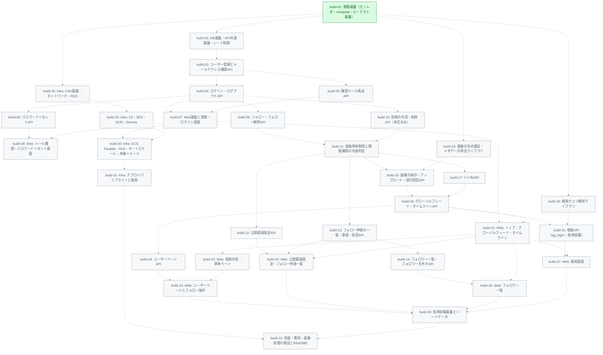

# ビルド一覧 — 001-mvp

ビルドの完了判定は `PR` 列が非空かどうかで行います。
`PR` 列の更新は当該ビルドの PR に同梱されるため、デフォルトブランチ上で
`PR` 列が埋まっていること自体がマージ済みを意味します。

依存関係のあるビルドは、先行ビルドがデフォルトブランチにマージ済みであることが必須です。
依存関係がないビルドは並行実行できます。

| buildID | title                                                 | BP | dependencies           | issue                        | PR |
| ------- | ----------------------------------------------------- | --- | ---------------------- | ---------------------------- | --- |
| 1       | 開発基盤（モノレポ・compose・CI・テスト基盤）         | 5  | —                      | [issue](./build-01/issue.md) | —  |
| 2       | DB基盤・API共通基盤・レート制限                       | 5  | 1                      | [issue](./build-02/issue.md) | —  |
| 3       | ユーザー登録とメールアドレス確認API                   | 5  | 2                      | [issue](./build-03/issue.md) | —  |
| 4       | ログイン・ログアウトAPI                               | 5  | 3                      | [issue](./build-04/issue.md) | —  |
| 5       | 確認メール再送API                                     | 3  | 3                      | [issue](./build-05/issue.md) | —  |
| 6       | パスワードリセットAPI                                 | 4  | 3, 4                   | [issue](./build-06/issue.md) | —  |
| 7       | Web基盤と登録・ログイン画面                           | 5  | 4, 5                   | [issue](./build-07/issue.md) | —  |
| 8       | Web: メール確認・パスワードリセット画面               | 5  | 5, 6, 7                | [issue](./build-08/issue.md) | —  |
| 9       | フォロー・フォロー解除API                             | 4  | 4                      | [issue](./build-09/issue.md) | —  |
| 10      | 投稿の作成・削除API（本文のみ）                       | 4  | 4                      | [issue](./build-10/issue.md) | —  |
| 11      | 投稿単体取得と閲覧権限の共通判定                      | 4  | 9, 10                  | [issue](./build-11/issue.md) | —  |
| 12      | 公開範囲設定API                                       | 4  | 9, 11                  | [issue](./build-12/issue.md) | —  |
| 13      | フォロー申請の一覧・承認・拒否API                     | 4  | 9, 11                  | [issue](./build-13/issue.md) | —  |
| 14      | フォロワー一覧・フォロワーを外すAPI                   | 4  | 13                     | [issue](./build-14/issue.md) | —  |
| 15      | 画像の形式検証・メタデータ除去ライブラリ              | 5  | 1                      | [issue](./build-15/issue.md) | —  |
| 16      | 画像の保存・アップロード・認可配信API                 | 5  | 10, 11, 15             | [issue](./build-16/issue.md) | —  |
| 17      | いいねAPI                                             | 4  | 11                     | [issue](./build-17/issue.md) | —  |
| 18      | グローバルフィード・タイムラインAPI                   | 4  | 9, 16, 17              | [issue](./build-18/issue.md) | —  |
| 19      | ユーザーページAPI                                     | 4  | 18                     | [issue](./build-19/issue.md) | —  |
| 20      | 検索クエリ解析ライブラリ                              | 3  | 1                      | [issue](./build-20/issue.md) | —  |
| 21      | 検索API（pg_bigm・負荷保護）                          | 4  | 18, 20                 | [issue](./build-21/issue.md) | —  |
| 22      | Web: トップ・グローバルフィード・タイムライン         | 4  | 7, 18                  | [issue](./build-22/issue.md) | —  |
| 23      | Web: 投稿作成・単体ページ                             | 4  | 16, 17, 22             | [issue](./build-23/issue.md) | —  |
| 24      | Web: ユーザーページとフォロー操作                     | 4  | 9, 19, 22, 23          | [issue](./build-24/issue.md) | —  |
| 25      | Web: 公開範囲設定・フォロー申請一覧                   | 4  | 12, 13, 22             | [issue](./build-25/issue.md) | —  |
| 26      | Web: フォロワー一覧                                   | 3  | 14, 22                 | [issue](./build-26/issue.md) | —  |
| 27      | Web: 検索画面                                         | 3  | 21, 22                 | [issue](./build-27/issue.md) | —  |
| 28      | infra: CDK基盤・ネットワーク・RDS                     | 5  | 1                      | [issue](./build-28/issue.md) | —  |
| 29      | infra: S3・SES・ECR・Secrets                          | 5  | 28                     | [issue](./build-29/issue.md) | —  |
| 30      | infra: ECS Fargate・ALB・オートスケール・本番イメージ | 4  | 7, 29                  | [issue](./build-30/issue.md) | —  |
| 31      | infra: デプロイパイプラインと監視                     | 4  | 30                     | [issue](./build-31/issue.md) | —  |
| 32      | 負荷試験基盤とシードデータ                            | 5  | 22, 23, 24, 25, 26, 27 | [issue](./build-32/issue.md) | —  |
| 33      | 性能・費用・画像処理の検証とREADME                    | 5  | 31, 32                 | [issue](./build-33/issue.md) | —  |

## 依存グラフ

紫: 完了（merged） / 緑: 着手可能（ready） / グレー: 待機中（blocked）。点線は先行ビルドが未完了の依存
